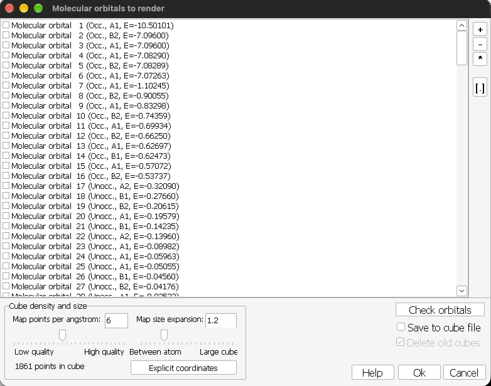

# AroMagnetic

AroMagnetic is a Python toolkit for evaluating **magnetic criteria of aromaticity** from quantum chemistry calculations.

The program automates the generation of ghost-atom grids, the reconstruction of the induced magnetic field (Bind), the calculation of NICS-based descriptors, the evaluation of ring-current strength, and the molecular orbital decomposition of magnetic response properties.

AroMagnetic integrates workflows typically performed manually when using Gaussian or ORCA.

---

## Capabilities

AroMagnetic implements the following magnetic descriptors:

- $B^{ind}_{z}$ (induced magnetic field)
- NICS-SP
- NICS-scan
- NICS-2D
- NICS-3D
- INICS (integral NICS)
- Ring current strength (Ampère–Maxwell law)
- MO decomposition of the magnetic response (Gaussian only)
- Pseudo-π model

### Automation features

- Automatic grid construction
- Automatic molecular orientation
- Automatic ring detection
- Symmetry-adapted grid reduction
- Automatic generation of .cube files
- Conversion from .cube to .vtk format
- Numerical integration of profiles
- Algebraic operations on scalar fields (.cube/.vtk)

---

## What can you create with AroMagnetic?

With AroMagnetic you can generate the scalar fields of $B^{ind}_{z}$ and NICS as `.cube` or `.vtk` files, and visualize them in your preferred software (for example, VMD or ParaView). From these files you can draw isosurfaces, which show the shape of the magnetic response in three dimensions, or isolines on a plane, which show its sign and decay in a two-dimensional section. The following figures were created from files generated by AroMagnetic. Blue regions correspond to negative values (shielding) and red regions to positive values (deshielding).

### Isosurfaces

Isosurfaces of $B^{ind}_{z}$ (left) and NICS (right) for [10]annulene, generated from the `.cube` files. The isovalues (−20 and 10 ppm) were set in the visualization software.

![Isosurfaces of Bind_z of [10]annulene](images/bind_10annulene_isosurfaces.png){ width="48%" }
![Isosurfaces of NICS of [10]annulene](images/nics_10annulene_isosurfaces.png){ width="48%" }

### Isolines

Isolines of $B^{ind}_{z}$ and NICS of [18]annulene, viewed from above (left panel) and from the side (right panel). The color scale ranges from −20 to 10 ppm.

![Isolines of Bind_z of [18]annulene](images/bind_18annulene_isolines.png)

![Isolines of NICS of [18]annulene](images/nics_18annulene_isolines.png)

---

## General workflow

AroMagnetic operates using an input file:

```text
INPUT.txt
```

Typical workflow:  

- Prepare calculation inputs
- Run Gaussian or ORCA
- Analyze the magnetic response

## Grid module
### Input format

```text
# ================================
#        AroMagnetic INPUT
# ================================

# --------------------------------
# General Information
# --------------------------------

NAME_MOLECULE             mol
PROGRAM                   Gaussian            # ORCA or GAUSSIAN
KEYWORD_LINE              Functional/Basis NMR INTEGRAL(SUPERFINEGRID) SCF=XQC

PROCS                     16 # Only used for Gaussian; for ORCA, set the number of processors in BEGIN_ORCA_BLOCK
MEMORY_GB                 32

CHARGE                    0
MULTIPLICITY              1

MOLECULAR_COORDINATES     mol.xyz
PSEUDO_PI                 NO              # YES or NO


# --------------------------------
# Module Switchboard
# --------------------------------
# Turn ON only what you need.

GRID_MODULE                 ON
PROFILE_MODULE             OFF
NICS_SCAN_XY_MODULE        OFF


# --------------------------------
# Grid (Grid generation)
# --------------------------------
# Required if GRID_MODULE = ON

BEGIN_GRID

GA_MAX            80               # Maximum number of ghost atoms per input
EXTERNAL_FIELD    0.0 0.0 1.0      # Bx By Bz
NUM_POINTS        19 19 19         # Nx Ny Nz
GRID_MARGIN       2.0              # Å
VTK_FILES         YES              # YES or NO

END_GRID
```

### Choosing the number of points: the voxel size

The quality of the maps of $B^{ind}_{z}$ and NICS depends on the separation between the points of the grid, called the **voxel coordinate** or step. A good value is between **0.2 and 0.3 Å** along each Cartesian axis. A larger step gives coarse maps and isolines; a smaller one gives smoother maps but needs many more ghost atoms, and therefore more calculations.

The step along each axis is

$$
V_x = \frac{l_x}{N_x - 1}, \qquad V_y = \frac{l_y}{N_y - 1}, \qquad V_z = \frac{l_z}{N_z - 1}
$$

where $V$ is the separation between points, $N$ is the number of points (`NUM_POINTS`) and $l$ is the length of the grid along that Cartesian axis.

You do not need to calculate it by hand: when the grid is generated (`amg run`), the program prints the steps on the screen (the numbers below are only an example),

```text
Calc grid         : N=(19,19,19)  step(Å)=(0.421053,0.421053,0.421053)  points=6859
```

and saves them in the file `grid_info.txt`, in the lines `SHAPE(N)` (the numbers of points), `STEP(angstroms)` (the voxel coordinates $V_x\ V_y\ V_z$) and `AXIS_LENGTHS(angstroms)` (the lengths $l_x\ l_y\ l_z$).

If a step is outside the 0.2–0.3 Å range, change `NUM_POINTS` in the `BEGIN_GRID` block and generate the grid again. For a desired step $V$, the number of points is

$$
N = \frac{l}{V} + 1
$$

For example, for an axis of length $l = 8.0$ Å, 19 points give a step of 0.44 Å, which is too large, while 33 points give 0.25 Å.

!!! note
    The lengths $l$ in `grid_info.txt` are those of the region that is actually calculated. If the molecule has mirror planes, the program calculates only part of the box and completes the rest by symmetry, so $l$ and $N$ refer to the calculated part. The step is the same in the complete grid.

### Isolines and isosurfaces of the induced magnetic field

The induced magnetic field ($B^{ind}_{z}$) calculated on the grid can be displayed in two complementary ways:

- **Isolines** (contour lines): lines of constant $B^{ind}_{z}$ drawn on a plane, usually a plane that crosses the ring perpendicular to the molecular plane, or a plane parallel to the ring at a given height. They show the sign and the decay of the field in a two-dimensional section.
- **Isosurfaces**: surfaces of constant $B^{ind}_{z}$ in three dimensions. Two surfaces, one for a positive and one for a negative value, enclose the deshielding and shielding regions, respectively, and give a global view of the shape of the response.

<!-- The two headings below are hidden until they have content. To publish them, move the
     heading out of the comment and add the figures under it.

     #### Published systems

     Add here the figures (isolines and isosurfaces) of systems that have already been published.
     For each system, write its name and its reference. Template:

     **System name.** Reference: Author, A.; Author, B. *Journal* **Year**, *Volume*, Pages.

     
     
-->

<!-- #### Systems not yet published

     Add here the figures of systems whose results have not been published yet.
     For each system, write its name and, if it applies, a note such as "unpublished results". -->


## Profile module
### Input format

```text
# ================================
#        AroMagnetic INPUT
# ================================

# --------------------------------
# General Information
# --------------------------------

NAME_MOLECULE             mol
PROGRAM                   Gaussian            # ORCA or GAUSSIAN
KEYWORD_LINE              Functional/Basis NMR INTEGRAL(SUPERFINEGRID) SCF=XQC

PROCS                     16 # If you use ORCA, this value doesn't appear in the input files
MEMORY_GB                 32

CHARGE                    0
MULTIPLICITY              1

MOLECULAR_COORDINATES     mol.xyz
PSEUDO_PI                 NO              # YES or NO


# --------------------------------
# Module Switchboard
# --------------------------------
# Turn ON only what you need.

GRID_MODULE                OFF
PROFILE_MODULE             ON
NICS_SCAN_XY_MODULE        OFF

# --------------------------------
# Profile (1D normal to ring)
# --------------------------------
# Required if PROFILE_MODULE = ON
#
# Linear scale requires:
#   START, DELTA_Z, NUM_GA
#
# Logarithmic scale requires:
#   START, END, NUM_GA

BEGIN_PROFILE

SCALE       Linear               # Linear or Logarithmic

START       0.0
DELTA_Z     0.1
NUM_GA      100

# Only for Logarithmic scale:
# END      5.0

END_PROFILE
```

## NICS-scan module
### Input format

```text
# ================================
#        AroMagnetic INPUT
# ================================

# --------------------------------
# General Information
# --------------------------------

NAME_MOLECULE             mol
PROGRAM                   Gaussian            # ORCA or GAUSSIAN
KEYWORD_LINE              Functional/Basis NMR INTEGRAL(SUPERFINEGRID) SCF=XQC

PROCS                     16 # If you use ORCA, this value doesn't appear in the input files
MEMORY_GB                 32

CHARGE                    0
MULTIPLICITY              1

MOLECULAR_COORDINATES     mol.xyz
PSEUDO_PI                 NO              # YES or NO


# --------------------------------
# Module Switchboard
# --------------------------------
# Turn ON only what you need.

GRID_MODULE                OFF
PROFILE_MODULE             OFF
NICS_SCAN_XY_MODULE        ON

# --------------------------------
# NICS Scan XY (Transversal scan)
# --------------------------------
# Required if NICS_SCAN_XY_MODULE = ON
#
# If both POINTS and DELTA_X are defined:
#   Code checks consistency. If inconsistent → error.

BEGIN_NICS_SCAN_XY

POINTS        81
MARGIN        2.0
HEIGHT        0.0 1.0 1.5
DELTA_X       0.1

MAKE_AXIS_Y   YES            # YES or NO

END_NICS_SCAN_XY
```

## Pseudo-π model

The pseudo-π model is an inexpensive way of isolating the **π-electron contribution** to the magnetic response of conjugated hydrocarbons. It was proposed by Fowler and Steiner (see [Methods and references](methods.md)): the carbon framework is formally replaced by hydrogen atoms, each with a single 1s function, so that the response of the model reproduces the π response of the original molecule.

### How it works in AroMagnetic

When the model is requested, AroMagnetic modifies the quantum chemistry inputs that it has just generated:

- every carbon atom is replaced by a hydrogen atom, and the original hydrogen atoms are removed;
- the ghost atoms of the grid or of the profiles, and atoms marked as dummy atoms (for example, `H:`), are retained;
- the rest of the input (keywords, basis set) is not changed.

The model is valid only for hydrocarbons and pure-carbon molecules (such as fullerene $\ce{C60}$). If other elements are present, the model is skipped and a warning is printed. When it is applied, the program prints `PSEUDO-π model was applied!`.

### How to use it

Set the keyword in the general section of `INPUT.txt`:

```text
PSEUDO_PI                 YES              # YES or NO
```

It works with the Grid module and with the profile modules. Then follow the usual workflow: generate the inputs with `amg run`, run them with Gaussian or ORCA, and analyze the results with `amg get`.

To compare the π contribution with the complete response, run the same system again in a separate folder with `PSEUDO_PI NO`.

## Interface with ORCA
### ORCA section

```text
# --------------------------------
# ORCA Block (Optional)
# --------------------------------
# Used only if PROGRAM = ORCA.
# If present, this block overrides PROCS/MEMORY_GB
# and adds advanced ORCA-specific settings.

BEGIN_ORCA_BLOCK

%pal
  nprocs 16
end

%maxcore 32000

END_ORCA_BLOCK
```

## How to run AroMagnetic

1. Prepare your `INPUT.txt` file and your molecular structure file (XYZ format).
    - If you are using a custom basis set (`Gen` keyword), you must create a `basis.txt` file containing the basis set definition, followed by two blank lines at the end of the file.
2. Generate the quantum chemistry input files:
```text
amg run
```
3. Run the generated input files using Gaussian or ORCA.
4. Once the calculations are finished, analyze the results:
```text
amg get
```
Depending on the selected module, this command generates .cube files (and .vtk files, if selected in INPUT.txt), .csv files and/or plots.

### Molecular orbital decomposition of the shielding tensor (Gaussian only)

The induced magnetic field (B<sup>ind</sup>) and the NICS can be split into the contributions of groups of canonical molecular orbitals (for example core, σ and π orbitals). AroMagnetic reads these contributions from the Gaussian outputs, where they are printed by the natural chemical shielding (NCS) analysis of **NBO6**, so this analysis requires Gaussian with NBO6. It is available for the **grid module**, and it produces one set of `.cube` files for each group of orbitals.

**1. Identify the molecular orbitals.** Before defining the groups, you need to know which molecular orbital is core, σ, π, etc. This is done once, in a separate Gaussian calculation of the same molecule (same geometry, functional and basis set as in the AroMagnetic calculation, without the dummy atoms), for example:

```text
%MEM=24GB
# CAM-B3LYP GEN
#P GFINPUT POP(FULL,NBO)

Comment

C M
** Coordinates **
```

where `C M` are the charge and the multiplicity of the molecule. With `Gen`, add the definition of the basis set after the coordinates, as in any Gaussian calculation. The keywords `GFINPUT` and `POP(FULL,NBO)` make Gaussian print the basis set and all the molecular orbitals, which programs such as ChemCraft need to read and display them.

Then open the output of this calculation in a molecular viewer and look at the orbitals. We recommend [ChemCraft](https://www.chemcraftprog.com/): its *Molecular orbitals to render* window lists every orbital with its number, occupation, symmetry and energy (in hartree), and the orbitals that you check there are drawn when you press *Ok*.

{ width="60%" }

Write down the number of the orbitals of each group. They are the numbers that you will use in the next step.

**2. Define the groups of orbitals in `INPUT.txt`.** Add the NBO keywords to the `KEYWORD_LINE` and list the groups in the `BEGIN_ORBITALS` block:

```text
KEYWORD_LINE    functional/basis POP=NBO6read NMR Integral(SuperFineGrid) SCF=XQC

BEGIN_ORBITALS
MO_core     1 2 3
MO_sigma    4 5 6
MO_pi       7 8 9
MO_others
END_ORBITALS
```

- Each line `MO_<name>` defines a group of orbitals, and the numbers are the molecular orbitals that you identified in step 1.
- A group without numbers (`MO_others` in the example) collects all the orbitals that you did not assign to any other group.
- Each orbital should appear in only one group. If an orbital is listed in two groups, its contribution is counted in both.
- The name of the group is written in capital letters in the names of the output files (`MO_pi` gives `..._PI.cube`).

**3. Generate the Gaussian input files:**
```text
amg run
```
When the `KEYWORD_LINE` contains `POP=NBO6read` (or `NBOread`, `NBO7read`), `amg run` adds the NBO keylist `$NBO NCS=0.0 XYZ MO $END` at the end of every input file, after the molecule specification, followed by the blank line that Gaussian needs at the end of the input. You do not have to write it yourself. If your calculation uses a custom basis set (`Gen`), the basis set is inserted before this line.

**4. Run the Gaussian calculations**, as in a normal AroMagnetic calculation.

**5. Perform the molecular orbital analysis** in the same folder, with the same `INPUT.txt`:
```text
amg mo
```
It plays the role of `amg get` for the orbital decomposition: instead of a single set of files for the total magnetic response, it writes the following files for each group `<NAME>` of the `BEGIN_ORBITALS` block (and `.vtk` files too, if `VTK_FILES YES` is set in the `BEGIN_GRID` block):

| File | Content |
|------|---------|
| `<name_molecule>_Bindx_<NAME>.cube` | x component of B<sup>ind</sup> due to the orbitals of the group |
| `<name_molecule>_Bindy_<NAME>.cube` | y component of B<sup>ind</sup> due to the orbitals of the group |
| `<name_molecule>_Bindz_<NAME>.cube` | z component of B<sup>ind</sup> due to the orbitals of the group |
| `<name_molecule>_NICS_<NAME>.cube` | NICS due to the orbitals of the group |

!!! note
    The molecular orbital analysis is implemented for the grid module (`GRID_MODULE ON`) and for Gaussian. With ORCA, or with the profile and NICS-XY-scan modules, the decomposition is not available.

### Available commands

Commands that read the input file (`amg run`, `amg get`, `amg mo` and `amg rings`) must be executed from the folder containing that file. The program can be invoked as either `amg` or `aromagnetic`; the two names are equivalent.

**Name of the input file.** The input file does not have to be called `INPUT.txt`. By default, the program uses the `INPUT.txt` file in the current folder, regardless of capitalization (`input.txt`, `Input.txt`, etc.). To use a file with a different name, specify it after the command, for example:

```text
amg run benzene_grid.txt
amg get benzene_grid.txt --interactive
```

Use the same file at every step of the workflow (`amg run`, then `amg get`, etc.).

| Command | Description |
|---------|-------------|
| `amg run [INPUT]` | Generates the quantum chemistry input files from `INPUT.txt` (or from the file `INPUT`, if one is given) |
| `amg get [INPUT]` | Reads the outputs and generates the `.csv` files, plots and integrals; the `--interactive` option launches the interactive mode of the NICS-XY-scan (Predi-XY) analysis |
| `amg mo [INPUT]` | Performs the molecular orbital decomposition analysis (Gaussian and grid module only) |
| `amg rings [INPUT]` | Shows an image with the ring numbering (for `PREDI_XY_PATH`) |
| `amg reset` | Removes the files generated by a previous run |
| `amg check` | Verifies that the Gaussian or ORCA calculations finished correctly |
| `amg add <f1> <f2>` | Adds two scalar fields saved in `.cube` or `.vtk` files (both files must be of the same type) |
| `amg sub <f1> <f2>` | Subtracts the second field from the first one (`.cube` or `.vtk`) |
