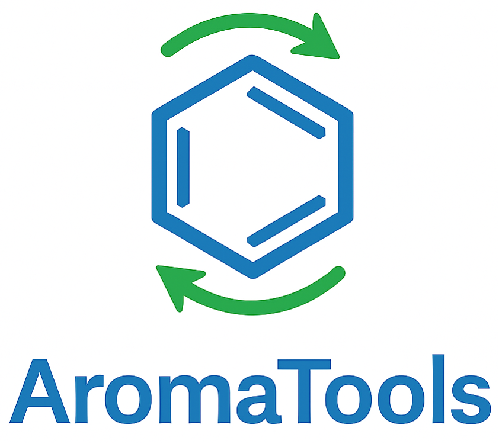

  

# AromaTools (version 1.0)

**AromaTools** is a computational toolkit designed to facilitate the analysis of aromaticity using complementary geometric, magnetic and electronic criteria.

The software integrates widely used descriptors into a unified and user-friendly workflow, allowing researchers to evaluate aromaticity in molecular systems systematically and reproducibly.

Aromaticity is not a directly observable physical property, but rather a conceptual framework inferred from different manifestations of electron delocalization. Because no single descriptor fully captures this phenomenon, reliable analysis typically requires the combined use of multiple criteria. AromaTools aims to simplify this process by providing automated workflows for the calculation and analysis of aromaticity indices derived from molecular structure, magnetic response, and electron delocalization.

---

## Main features

### Unified aromaticity analysis
AromaTools integrates multiple descriptors commonly used to characterize aromaticity:

**Geometric criteria**  

- HOMA93 (harmonic oscillator model of aromaticity, original parameters)  
- HOMAc (HOMA reparameterized with aromatic and antiaromatic reference systems)  
- HOMER (HOMA reparameterized for the lowest triplet excited state)  
- BLA (bond-length alternation)

**Magnetic criteria**   

- NICS (nucleus-independent chemical shift: SP, 2D, 3D)  
- NICS-scan  
- Integral NICS (INICS)  
- Induced magnetic field (Bind)  
- Ring current strength (Ampère–Maxwell approach)  
- Molecular orbital decomposition of the shielding tensor (Gaussian only)  
- Pseudo-π model implementation for π-electron magnetic response analysis  
- Generation of scalar fields (.cube) and visualization grids (.vtk)  

**Electronic criteria**  

- Iring (multicenter bond index)  
- MCI (multicenter index)  
- PDI (para-delocalization index)  
- FLU (aromatic fluctuation index)  
- AV1245 and AVmin (average and minimum of the four-center indices, for large rings)  
- BOA and BOAc (bond-order alternation)  
- DI (delocalization indices) and atomic populations  
- Atomic partitions: meta-Löwdin, NAO (natural atomic orbitals), IAO (intrinsic atomic orbitals), Löwdin, Mulliken, and QTAIM (quantum theory of atoms in molecules, from AIMAll files)  
- Wavefunctions from PySCF or from files (.fchk, .molden and other formats readable by IOData)  

The electronic indices are computed with [ESIpy](https://github.com/jgrebol/ESIpy); AroElectronic prepares the wavefunction and the atomic partition and runs ESIpy.  

These descriptors provide complementary perspectives on electron delocalization in cyclic systems. The geometric and electronic criteria analyze rings; open chains are not supported.

---

### Automated workflows

The code is designed to minimize manual intervention and reduce sources of error:

- Automatic detection of molecular rings
- Automatic construction of spatial grids
- Automatic molecular orientation based on principal moments of inertia
- Automated preparation of quantum chemistry inputs
- Automatic post-processing of outputs
- Automatic generation of plots and tables in `.csv` format

This approach improves reproducibility and allows users to focus on chemical interpretation rather than technical setup.

---

## Design philosophy

AromaTools was developed with the following objectives:

- Provide a unified platform for aromaticity analysis
- Reduce fragmentation between different computational tools
- Facilitate reproducible workflows
- Minimize manual preparation of inputs
- Simplify post-processing of results
- Allow flexible integration with common quantum chemistry software

The software is particularly suited for studies involving:

- Aromatic and antiaromatic systems
- Heterocycles
- Excited-state aromaticity
- Magnetic response analysis

---

## Developers

- **Fernando Martínez-Villarino**  
Computational Physical Chemistry  
Doctoral student at Cinvestav - Mérida, Mexico

- **Joan Grèbol-Tomàs**  
Computational Chemistry  
Doctoral student at Universitat de Girona - Girona, Spain

- **Mesías Orozco-Ic**  
Computational Physical Chemistry  
Postdoctoral researcher at Cinvestav - Mérida, Mexico

- **Pedro Salvador**  
Computational Chemistry  
Research professor at Universitat de Girona - Girona, Spain

- **Eduard Matito**  
Computational Chemistry  
Research professor at Donostia International Physics Center - Donostia, Spain

- **Gabriel Merino**  
Computational Physical Chemistry  
Research professor at Cinvestav - Mérida, Mexico

---

## Citation

AromaTools integrates methods developed by different research groups. Each method and the work in which it was proposed are listed in [Methods and references](methods.md); please cite them together with AromaTools.

If you use AromaTools in your research, please cite:

Martínez-Villarino, F.; Grèbol-Tomàs, J.; Salvador, P.; Orozco-Ic, M.; Matito, E.; Merino, G. AromaTools 1.0, Cinvestav - DIPC, Mérida, Mexico, 2026.

---

## Future developments

AromaTools is under active development and several new features are currently being implemented to expand the scope of aromaticity analysis.

**AroGeometric**

Planned improvements for upcoming versions include:

- Detection of equivalent rings to reduce computational cost
- Multi-system HOMA index calculation

**AroMagnetic**

Planned improvements for upcoming versions include:

- Implementation of workflows compatible with **Turbomole**
- Calculation of **Bind** and **NICS** decomposed by molecular orbital (MO) with ORCA
- Implementation of the **NICS2BC** methodology for the visualization of current pathways derived from NICS data
- Improved exploitation of **molecular symmetry** in the profile module and **NICS-scan**
- Support for reading output files (.out, .log) from ORCA and Gaussian, and other ASE-compatible formats

These developments aim to improve the interpretation of magnetic response descriptors and facilitate the connection between molecular electronic structure and aromatic behavior.

---

**AroElectronic**

The electronic criteria are now available in the AroElectronic module, which uses [ESIpy](https://github.com/jgrebol/ESIpy) to compute the indices and allows AromaTools to provide a unified framework combining geometric, magnetic, and electronic criteria. This integration facilitates comparison of the different aromaticity criteria and provides deeper insight into the nature of cyclic electron delocalization.

---

AromaTools continues to evolve toward a unified platform for multidimensional aromaticity analysis.
